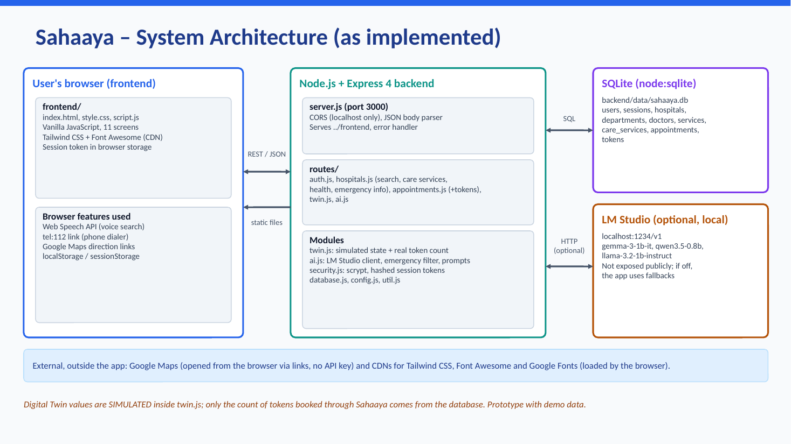

# Sahaaya – Smart Healthcare Navigation System

**Your Health. Our Support.**

> **Proof-of-concept prototype.** Hospital information, waiting times, bed availability, token availability and Digital Twin values in this project are **simulated demo data**. Sahaaya is **not connected to any live hospital system**. It gives no medical advice. In an emergency call **112** (ambulance **108**).


## Mandatory submission items (index)

| # | Required item | Where in this README |
|---|---|---|
| 1 | Project Title | [Section 1](#1-project-title) |
| 2 | Team details | [Section 2](#2-team-details) |
| 3 | College / Incubator information | [Section 3](#3-college--incubator-information) |
| 4 | Problem Statement | [Section 4](#4-problem-statement) |
| 5 | Healthcare Use Case | [Section 5](#5-healthcare-use-case) |
| 6 | Technical Stack | [Section 6](#6-technical-stack) |
| 7 | AI/ML Model or Framework Details | [Section 7](#7-aiml-model-or-framework-details) |
| 8 | Demo Video (Unlisted YouTube, 15–20 min) | [Section 8](#8-demo-video) |
| 9 | Open-source License Details | [Section 9](#9-open-source-license-details) |
| 10 | Architecture Diagram (PDF/PPT) | [Section 10](#10-architecture-diagram) |
| 11 | Presentation (PDF/PPT) | [Section 11](#11-presentation) |
| 12 | Public accessibility | [Section 12](#12-public-accessibility) |

---

## 1. Project Title

**Sahaaya – Smart Healthcare Navigation System** (tagline: *Your Health. Our Support.*)

Submitted to the Digital Twin Challenge as a proof-of-concept prototype with code.

## 2. Team Details

| Field | Details |
|---|---|
| Team name | **[FILL IN]** |
| Member 1 (name, role) | **[FILL IN]** |
| Member 2 (name, role) | **[FILL IN]** |
| Additional members | **[FILL IN or delete this row]** |
| Contact email | **[FILL IN]** |

## 3. College / Incubator Information

| Field | Details |
|---|---|
| College / institution | **[FILL IN]** |
| Department / programme | **[FILL IN]** |
| City, state | **[FILL IN]** |
| Incubator (if any) | **[FILL IN, or write "Not applicable"]** |

## 4. Problem Statement

When someone needs care, finding the right hospital and department is slow and stressful. People often do not know which nearby hospital offers a service, how crowded it is, how to book a visit, or what to do in an emergency. Language barriers make this harder. Information is spread across phone calls, walk-ins and separate hospital websites. (This is a general problem framing; no survey data was collected for this prototype.)

## 5. Healthcare Use Case

**Use case: patient navigation and visit planning.** A patient or family member can:

1. Find a hospital or department by name, service, location or a simple sentence such as "Which hospital has cardiology?".
2. See a **simulated** picture of how busy each hospital is (Digital Twin) before travelling.
3. Book an appointment and receive a demo token, then track or cancel it.
4. Open Google Maps directions to the hospital.
5. Reach emergency help (`tel:112`) quickly and get a fixed safety warning for emergency messages.
6. Ask a local AI assistant simple questions, in English, Telugu, Hindi, Tamil or Kannada.

**Target users:** patients and families, including people who prefer a local language, and caregivers planning a visit. Hospital front-desk or administrator tools are future scope and are not built.

## 6. Technical Stack

| Layer | Technology |
|---|---|
| Frontend | HTML, CSS, vanilla JavaScript; Tailwind CSS and Font Awesome loaded from CDNs; Inter font via Google Fonts; browser Web Speech API for voice search |
| Backend | Node.js 22.13 or newer, Express 4 (REST JSON API); scrypt password hashing and hashed session tokens (Node `crypto`) |
| Database | SQLite through Node's built-in `node:sqlite` (file created automatically in `backend/data/`) |
| Local AI | LM Studio local server (optional) with Gemma 3 1B, Qwen 3.5 0.8B or Llama 3.2 1B |
| Maps | Google Maps direction links (no API key, no Maps API) |
| Digital Twin | A simulation model written in JavaScript (`backend/twin.js`) |

No paid API and no API keys are used anywhere in the project.

## 7. AI/ML Model or Framework Details

**Framework:** [LM Studio](https://lmstudio.ai) running on the same computer, used through its OpenAI-compatible HTTP API at `http://localhost:1234/v1`. Only the backend talks to it. It is not exposed to the internet.

**Models (optional, tried in this order, configurable in `backend/config.js`):**

1. `gemma-3-1b-it`
2. `qwen3.5-0.8b`
3. `llama-3.2-1b-instruct`

**How it is used:**

- **No model is trained or fine-tuned.** The models are used as they are, with prompt design only (temperature 0.3, short answers).
- A system prompt tells the model to use **only** the hospital facts provided, never diagnose, never suggest medicines or doses, call queue and bed numbers "estimated/simulated", and answer in the selected language (or simple English if it cannot).
- The facts are read from the database for every request and added to the prompt together with the current (simulated) Digital Twin numbers. No embedding model or vector search is used.
- **Assistant:** answers questions on the Voice & Language screen.
- **Explain with AI:** turns a hospital's twin numbers into 3 short plain-language sentences.
- Every AI answer is labelled **AI-generated** with a note that AI can make mistakes and is not medical advice.

**Safety and fallbacks (rule-based, no model involved):**

- Emergency phrases (for example chest pain or not breathing, in English, Hindi, Telugu, Tamil and Kannada) return a fixed warning with a **Call 112** button. The model is never asked.
- If LM Studio is off or no model answers, the app does not crash: the assistant falls back to a simple keyword search of the database, and "Explain with AI" falls back to an automatic summary. Both say that local AI is unavailable in the current environment.

**Not machine learning:** the Digital Twin values come from a deterministic simulation (a daily demand curve with two peaks plus smooth variation), not from an ML model. The natural-language hospital search is keyword and synonym matching, not ML.

**Known limits:** these are small (about 1B parameter) models. They make mistakes and are weaker in Telugu, Tamil and Kannada.

## 8. Demo Video

**Unlisted YouTube video (15–20 minutes):**

> https://youtu.be/ECCzLyiBAng?si=Bz4D3iXCm8LPlz_X 

The recording plan, timings and narration points are in [docs/DEMO_VIDEO_SCRIPT.md](docs/DEMO_VIDEO_SCRIPT.md).

## 9. Open-source License Details

- **License:** MIT License. The full text is in the [LICENSE](LICENSE) file at the root of this repository (the copyright holder is named there).
- You may use, copy, modify and distribute this code under the MIT terms.
- **Third-party components keep their own licenses:** Express and Tailwind CSS (MIT), Font Awesome Free (icons CC BY 4.0, fonts SIL OFL 1.1, code MIT), the Inter font (SIL OFL 1.1).
- **AI models are not included in this repository.** Gemma, Qwen and Llama models have their own license terms; check each model's page before reuse.

## 10. Architecture Diagram

Files (PDF and editable PowerPoint):

- [docs/Sahaaya-Architecture-Diagram.pdf](docs/Sahaaya-Architecture-Diagram.pdf)
- [docs/Sahaaya-Architecture-Diagram.pptx](docs/Sahaaya-Architecture-Diagram.pptx)



The diagram shows only what exists in the code: the browser frontend, the Express backend (routes and modules), the SQLite database, the optional local LM Studio server, and the external Google Maps links and CDNs.

## 11. Presentation

15-slide presentation covering the problem, use case, solution, Digital Twin concept, AI details, stack, architecture, demo flow, outcomes, limitations, future scope and the demo-data disclaimer:

- [docs/Sahaaya-Presentation.pdf](docs/Sahaaya-Presentation.pdf)
- [docs/Sahaaya-Presentation.pptx](docs/Sahaaya-Presentation.pptx)

## 12. Public Accessibility

- This project is published as a **public GitHub repository**, so the code and documents can be opened without logging in or requesting permission.
- Every document referred to in this README (the architecture diagram, the presentation, the demo-video script, the license and the screenshots) is stored **inside this repository**, so no external permission is needed to read them.
- The demo video is uploaded to YouTube as **Unlisted**, which means anyone with the link can watch it without signing in (link in [Section 8](#8-demo-video)).
- The app runs locally. There is no hosted demo link.

---

# Project details

## Key Features

- 11 screens: Home, Login, Hospitals List, Hospital Details, Book Appointment, Voice & Language, Appointments & Tracking, Pharmacy & Labs, Token Allocation, Map View, Multi-Language.
- Hospital search by name, department, service or location, including simple sentences.
- Accounts: signup and login; each account sees only its own appointments.
- Appointment booking with a demo token saved in SQLite; cancelling releases the token.
- Digital Twin card for each hospital (simulated, see below).
- Local AI assistant and "Explain with AI", with fallbacks when the AI is off.
- Emergency button (`tel:112`) and an emergency safety reply.
- Voice search through the browser's speech recognition (Chrome or Edge).


## Digital Twin Concept

A digital twin is a virtual copy of a real system that mirrors its state. In Sahaaya each hospital has a twin that shows:

- estimated people waiting and estimated waiting time
- simulated bed availability and doctors on duty
- a simulated crowd level (Low, Moderate, High) and a 2-hour trend

**What is simulated and what is real:** the walk-in load, beds and doctors are generated by a smooth, repeatable model of the time of day (`backend/twin.js`). The only real input is the number of tokens booked **through Sahaaya**, read from the database and added to the queue. These numbers are never presented as live hospital data.

The twin lives in one file on purpose: a real deployment would replace its `simulate()` function with verified feeds and the rest of the app would not need to change.


## Healthcare Navigation

- Search and filter hospitals (Government or Private); view departments, doctors, services and sample timings.
- **Directions:** the buttons open Google Maps directions (Car, Bike or Walk) from a demo start point. The map picture inside the app is a labelled demo; there is **no live GPS and no live traffic**.
- Book an appointment: choose hospital, department, doctor, date and a fixed demo time slot, then receive a demo token.
- Pharmacy and lab information is sample data; ordering is not connected.


## Emergency Assistance

- The Emergency Help button is a `tel:112` link, so your phone opens its dialer. The app cannot place calls itself.
- Emergency wording in a message to the assistant shows a fixed warning with a **Call 112** button, also when the AI is off.
- Sahaaya does not diagnose. It encourages people to get professional emergency help immediately.

## Multi-language Support

- Interface labels in English, Telugu, Hindi, Tamil and Kannada; the header and main labels change when you pick a language.
- Voice search uses the selected language's speech recognition when the browser supports it.
- The assistant is asked to reply in the selected language, but small models may answer in English instead.
- Translations cover main labels only and should be reviewed by native speakers.

## System Architecture and API

```
Browser (HTML + Tailwind + JavaScript)
      |  REST (JSON)
Express backend ---- SQLite (users, hospitals, appointments, tokens)
      |
      +---- Digital twin model (backend/twin.js)  [simulated]
      +---- LM Studio on localhost:1234  [optional, local only]
```

The backend also serves the frontend, so one command runs everything. See [Section 10](#10-architecture-diagram) for the full diagram.

| Method | Path | Purpose |
|---|---|---|
| GET | `/api/health` | Server and database check |
| POST | `/api/auth/register`, `/api/auth/login`, `/api/auth/logout` | Accounts |
| GET | `/api/hospitals?q=&type=` | List and search hospitals |
| GET | `/api/hospitals/:id`, `/api/search?q=` | Details and combined search |
| GET | `/api/care-services?kind=pharmacy\|lab` | Pharmacy and lab services |
| POST | `/api/appointments` | Book (login required), creates a token |
| GET | `/api/appointments`, `/api/tokens/:id` | My appointments and token status |
| POST | `/api/appointments/:id/cancel` | Cancel and release the token |
| GET | `/api/tokens/availability` | Simulated token capacity minus tokens booked through Sahaaya |
| GET | `/api/twin`, `/api/twin/:id` | Digital twin state and history (simulated) |
| GET | `/api/ai/status`, POST `/api/ai/chat`, POST `/api/ai/explain-twin` | Local AI |

## Demo Data / Prototype Limitations

| Item | Status |
|---|---|
| Hospital names, doctors, addresses, timings | Sample data (Bhimavaram demo set) |
| Waiting time, queue length, crowd level | **Simulated** |
| Bed availability, doctors on duty | **Simulated** |
| Token availability | **Simulated** (demo capacity of 40 per department per day, minus tokens booked through Sahaaya) |
| Appointment time slots | Fixed demo slots |
| Tokens booked through Sahaaya | Real records in the local database, but **not** registered with any hospital |
| Accounts and appointments | Real records in the local SQLite database |
| AI explanations | Generated from the prototype data above; can be wrong |
| Hospital data source | **Not connected to any live hospital database** |

## Future Scope

These are ideas, **not** implemented features:

- Real hospital data integration from verified healthcare sources
- OpenStreetMap-based location services and a city selector
- Real hospital APIs and real-time availability where officially available
- Improved multilingual voice and translation quality
- Production-grade authentication and security
- Scalable cloud deployment

## How to Run Locally

1. Install [Node.js](https://nodejs.org) (LTS, 22.13 or newer).
2. In a terminal inside the `backend` folder run:
   ```
   npm install
   npm start
   ```
   On Windows, if PowerShell blocks `npm`, use Command Prompt.
3. Open **http://localhost:3000**.
4. Sample demo account (local prototype only): `madhuri@sahaaya.care` / `demo1234`, or sign up with your own details.

The database file is created automatically in `backend/data/`.

**Optional AI:** install LM Studio, load a small chat model (for example Gemma 3 1B), open **Developer** and switch on **Start Server** (port 1234). Without it the app still works and uses the fallbacks described above. To change the model or address, set `SAHAAYA_MODEL` or `LM_STUDIO_URL`, or edit `backend/config.js`.

## Project Structure

```
Sahaaya/
├── frontend/
│   ├── index.html
│   ├── style.css
│   └── script.js
├── backend/
│   ├── package.json
│   ├── server.js
│   ├── database.js
│   ├── config.js
│   ├── util.js
│   ├── security.js
│   ├── twin.js
│   ├── ai.js
│   └── routes/
│       ├── auth.js
│       ├── hospitals.js
│       ├── appointments.js
│       ├── twin.js
│       └── ai.js
├── docs/
│   ├── Sahaaya-Architecture-Diagram.pdf / .pptx / .png
│   ├── Sahaaya-Presentation.pdf / .pptx
│   ├── DEMO_VIDEO_SCRIPT.md
│   └── screenshots/
│       ├── home.png
│       ├── hospital-details-twin.png
│       ├── assistant.png
│       └── booking-token.png
├── README.md
└── LICENSE
```

`backend/node_modules/` and `backend/data/` are generated on your computer and are not part of the repository.

## Screenshots

| Home | Digital Twin |
|---|---|
|  |  |

| AI Assistant | Appointment and token |
|---|---|
|  |  |

## Disclaimer

Sahaaya is a proof-of-concept prototype created for a challenge submission. It is not a medical device or a hospital-management system. All hospital information, waiting times, bed counts, token numbers and Digital Twin values are simulated. AI-generated text can be wrong and is not medical advice. In an emergency call 112 or go to the nearest hospital.

Released under the MIT License (see [LICENSE](LICENSE)).
